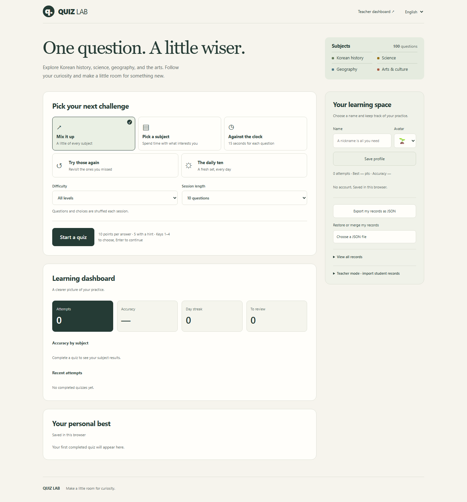

# Vibe Coding Study Quiz Program

[한국어](./README.md) | **English**

A quiz app for vibe coding practice. Built with HTML, CSS, and JavaScript.



## Run

Open `index.html` in a browser. No installation or account is needed, and the app works offline.

For a local server, use Node.js 22 or later:

```sh
npm ci
npm start
```

Then open `http://localhost:4173`.

## Features

- 100 questions across Korean history, science, geography, and arts and culture
- Korean and English interfaces, questions, hints, explanations, and reports
- Shuffled questions and choices, difficulty filters, and 10/20/full sessions
- Mixed practice, subject practice, 15-second speed rounds, a daily ten, and mistake review
- Personal stats, accuracy by subject, study streaks, and recent attempts
- JSON backup and restore, plus teacher reports with HTML and CSV downloads
- Responsive layout and keyboard controls

Correct answers earn 10 points, or 5 after a hint. Use keys 1–4 to answer and Enter to continue. Daily questions stay the same for the device's local date. A later correct answer clears a question from the review list.

## Data and questions

Profiles and the latest 100 attempts stay in the current browser's storage. There is no server upload or analytics tracking. Export JSON to move your history between browsers. Exported records and teacher reports contain the names and scores you enter; keep them out of public repositories.

[Question sources](docs/question-sources.md) document references and the review scope. [Design notes](docs/design-notes.md) list the projects that informed feature choices.

## Development

```sh
npm test
npm run check
npx playwright install chromium
npm run test:browser
npm run build
```

Browser tests use installed Edge on Windows and Playwright Chromium elsewhere. Set `PLAYWRIGHT_CHANNEL` to select another channel.

Deploy the contents of `dist/` to any static host. The build includes only app files and an empty teacher report. Teacher grades are relative to the imported group and do not adjust for different modes or difficulty levels.
