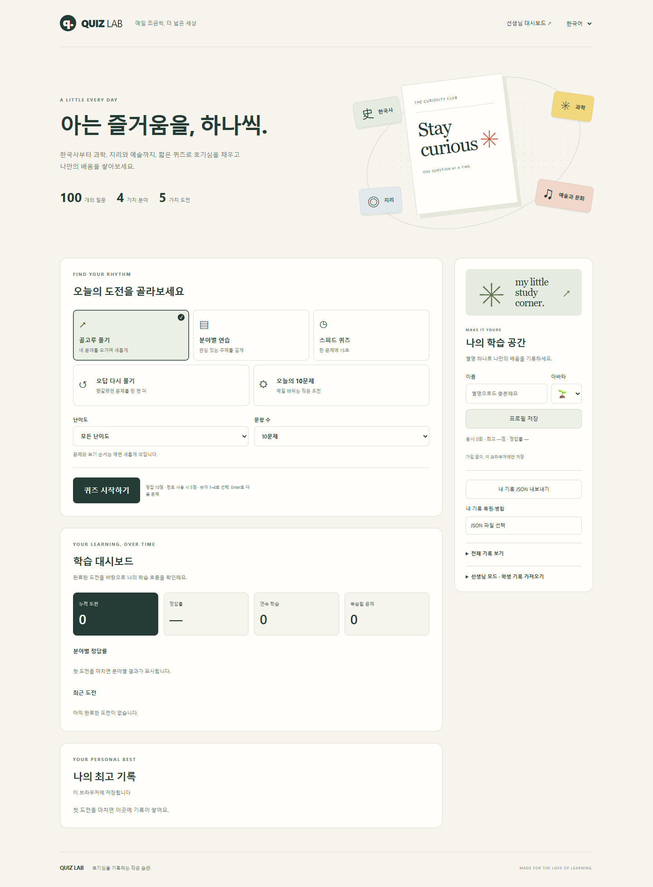

# Vibe Coding Study Quiz Program

**한국어** | [English](./README.en.md)

바이브 코딩 공부용으로 만든 퀴즈 앱입니다. HTML, CSS, JavaScript만으로 동작합니다.



## 실행

`index.html`을 브라우저에서 열면 됩니다. 설치나 계정 없이 오프라인으로 사용할 수 있습니다.

로컬 서버로 실행하려면 Node.js 22 이상에서:

```sh
npm ci
npm start
```

브라우저에서 `http://localhost:4173`에 접속하세요.

## 기능

- 한국사·과학·지리·예술과 문화 100문항, 한국어·영어 전환
- 문제와 보기 무작위 출제, 난이도와 10·20·전체 문항 선택
- 전체·분야별·15초 스피드·오늘의 10문제·오답 복습
- 힌트, 정답 해설, 참고 출처와 키보드 조작
- 개인 대시보드, 분야별 정답률, 연속 학습일과 최근 기록
- 기록 JSON 백업·복원, 교사용 보고서 가져오기와 HTML·CSV 저장
- 모바일 화면과 키보드 접근성 지원

정답은 10점, 힌트를 사용한 정답은 5점입니다. 오늘의 도전은 기기의 날짜를 기준으로 같은 날 같은 10문제를 출제합니다. 오답 복습에서는 나중에 맞힌 문제를 제외합니다.

## 데이터와 문항

프로필과 최근 100회 기록은 현재 브라우저의 저장소에 보관됩니다. 서버 전송이나 분석 추적은 없습니다. 다른 브라우저로 옮길 때는 JSON을 내보내세요. 내보낸 파일과 교사 보고서에는 입력한 이름·성적이 포함되므로 공개 저장소에 넣지 마세요.

추가한 48문항의 참고 자료와 기존 문항의 검토 범위는 [문항 출처](docs/question-sources.md)에 기록했습니다.

## 개발과 배포

```sh
npm test
npm run check
npx playwright install chromium
npm run test:browser
npm run build
```

Windows의 브라우저 검사는 설치된 Edge를 사용합니다. 다른 환경에서는 Playwright Chromium을 사용하며, `PLAYWRIGHT_CHANNEL`로 채널을 지정할 수 있습니다.

`dist/`만 정적 호스팅에 올리면 됩니다. 빌드에는 앱 파일과 빈 교사 보고서만 포함됩니다. 교사 보고서의 상대 등급은 모드·난이도 차이를 보정하지 않으므로 학습 참고용으로 사용하세요.

참고한 프로젝트는 [design notes](docs/design-notes.md)에 정리했습니다.
